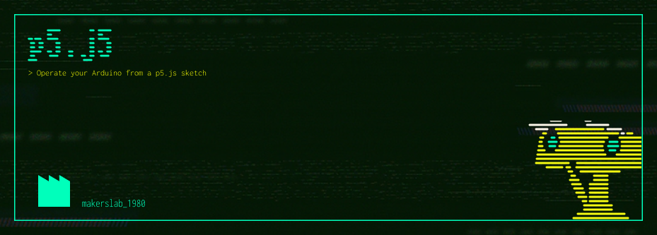

## 👉🏻👉🏻👉🏻 [https://methio.github.io/p5.j5/](https://methio.github.io/p5.j5/) 👈🏻👈🏻👈🏻

Easily control an **Arduino** from a static web page using the latest version of **p5.js**. This library is built on the **Web Serial** API and the **Firmata** protocol.

📖 **Documentation and demo**

This library is an update of [monteslu/p5.j5](https://github.com/monteslu/p5.j5) (based on Johnny-Five).

## Acknowledgments

- [Luis Montes](https://github.com/monteslu) for p5.j5
- the [Johnny-Five](https://johnny-five.io/) team for the API
- the [Firmata](https://github.com/firmata/protocol) project for the protocol.

*Library port created with the help of the Sonnet5.5 model.*